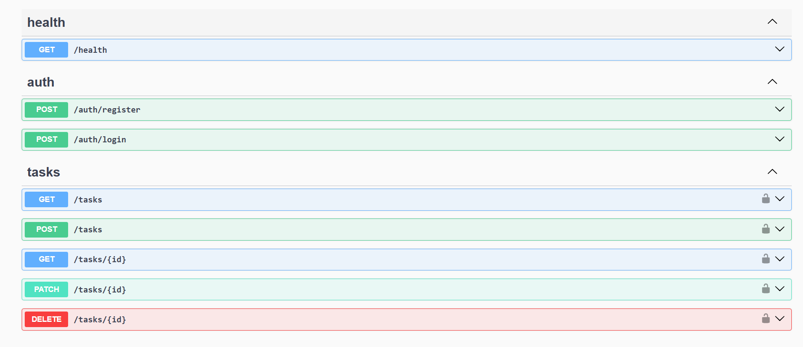

# Task Manager API

REST API for a task manager app, built with NestJS, Sequelize and MySQL. Users register, log in with JWT, and manage their own tasks.

**Live API docs:** coming soon  
**Frontend repo:** https://github.com/Tahura-Nafees/task-manager-web.git



## Features

- JWT authentication (register, login) with bcrypt-hashed passwords
- Task CRUD scoped to the authenticated user (users can never access each other's tasks)
- Filter tasks by status
- Request validation with class-validator
- Swagger / OpenAPI documentation

## Tech stack

NestJS 10, TypeScript, Sequelize (sequelize-typescript), MySQL, Passport JWT, Swagger

## Getting started

1. Clone the repo and install dependencies:
   ```bash
   npm install
   ```
2. Create a MySQL database named `task_manager`.
3. Copy `.env.example` to `.env` and fill in your values.
4. Start the dev server:
   ```bash
   npm run start:dev
   ```
5. Open Swagger at http://localhost:3000/api

## Environment variables

| Variable                                                      | Description                                  |
| ------------------------------------------------------------- | -------------------------------------------- |
| `PORT`                                                        | Server port (default 3000)                   |
| `DB_HOST`, `DB_PORT`, `DB_USERNAME`, `DB_PASSWORD`, `DB_NAME` | MySQL connection                             |
| `DB_SSL`                                                      | `true` for hosted databases that require SSL |
| `DB_SYNC`                                                     | `true` creates missing tables on startup     |
| `JWT_SECRET`                                                  | Secret used to sign tokens                   |
| `CORS_ORIGIN`                                                 | Allowed frontend origin(s), comma-separated  |
| `NODE_ENV`                                                    | `development` or `production`                |

## API overview

| Method | Route            | Auth | Description                              |
| ------ | ---------------- | ---- | ---------------------------------------- |
| POST   | `/auth/register` | No   | Create account, returns token            |
| POST   | `/auth/login`    | No   | Log in, returns token                    |
| GET    | `/tasks?status=` | Yes  | List your tasks (optional status filter) |
| POST   | `/tasks`         | Yes  | Create a task                            |
| GET    | `/tasks/:id`     | Yes  | Get one task                             |
| PATCH  | `/tasks/:id`     | Yes  | Update a task                            |
| DELETE | `/tasks/:id`     | Yes  | Delete a task                            |
| GET    | `/health`        | No   | Health check                             |

## Scripts

`npm run start:dev` · `npm run build` · `npm run start:prod` · `npm run lint`
